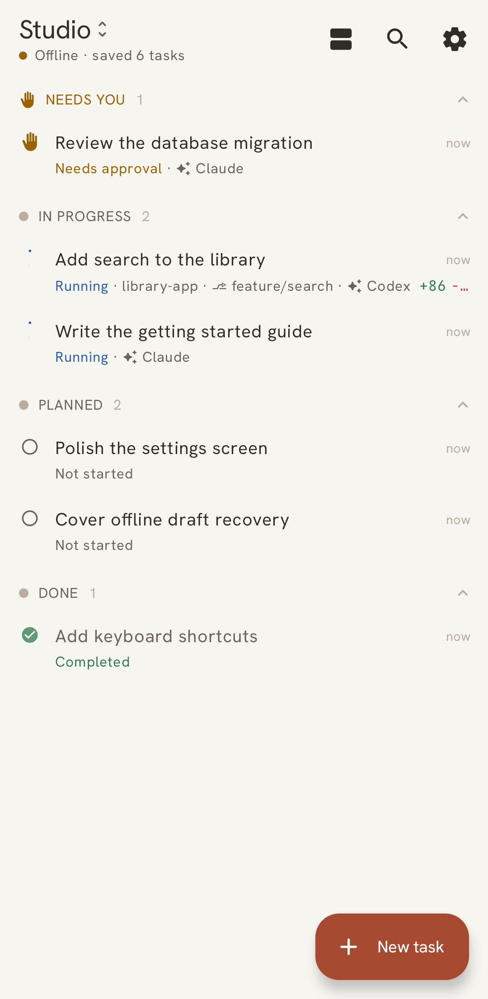
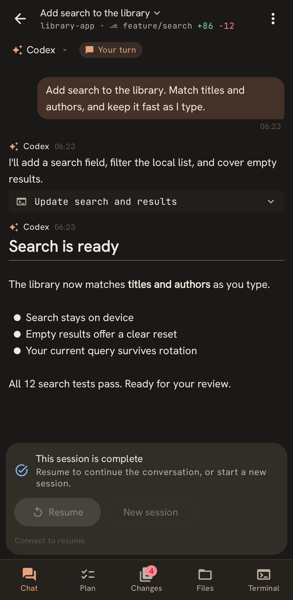

# Forge for Android

Forge is a native Android client for your own [Kandev](https://github.com/kdlbs/kandev) instance. Follow coding agents, review approvals, answer questions, edit plans and files, inspect diffs, and use a terminal from your phone.

**Compatibility:** Kandev **v0.98.0** only; Android **8.0+** (API 26). Other Kandev versions are rejected. This is a community client, not an official Kandev or agent-provider app.

## Screenshots

These captures use synthetic example tasks, with no private server or conversation data.

| Tasks · light | Conversation · dark |
| --- | --- |
|  |  |

## What you need

- A running Kandev v0.98.0 instance with a workspace. Forge does not install or host Kandev.
- A server address your phone can reach, and a Kandev API token if authentication is enabled.
- Either the signed APK from this repository's [latest release](../../releases/latest), or a source build (JDK 17,
  Android SDK Platform 36 and Build Tools 36.0.0; the Gradle wrapper is included).

**Install a release:** download `forge-<version>.apk` from [Releases](../../releases/latest), allow your browser or
file manager to install apps, and open it. Each release lists the APK's SHA-256 and signing-certificate fingerprint and
carries a GitHub build attestation (`gh attestation verify forge-<version>.apk --repo OWNER/REPOSITORY`). Release APKs
check this repository's releases for updates; they do not include Firebase, so away alerts need a source build with your
own Firebase project (see [relay/README.md](relay/README.md)). Everything else, including live notifications while the
app can reach your server, works without it.

**Start with direct LAN or Tailscale access.** Cloudflare, Firebase, a domain, and the relay are optional. Each deployment owns its server, credentials, and optional cloud accounts; no connection to the author's infrastructure is needed.

## Optional integrations and dependencies

Provider usage, push delivery and remote routing are independent additions. The [dependency and
integration guide](docs/OPTIONAL_INTEGRATIONS.md) lists where each component runs, how to set it
up, and what happens when it is absent. In particular, the usage strip needs the server-side
Provider Usage plugin and CodexBar; neither is required to connect or chat. Use the documented
plugin version compatible with Kandev v0.98.0 rather than installing its development branch.

## Build and connect

From your clone of this repository:

```sh
# Point this at your installed Android SDK, or set sdk.dir in local.properties.
export ANDROID_HOME="$HOME/Android/Sdk"
./gradlew :app:assembleDebug
adb install -r app/build/outputs/apk/debug/app-debug.apk
```

No Firebase file or release signing key is required for this build. Open Forge, enter your server's **base address**, for example `http://192.168.1.10:38429` or `https://kandev.example.com`, enter the API token if required, and tap **Connect**. Do not append `/api/v1` or `/ws`. Choose a workspace if prompted.

Verify the version from a machine on the same network:

```sh
curl --fail http://192.168.1.10:38429/api/v1/system/info
# Expected: JSON with version "0.98.0" (add Authorization: Bearer … if required).
```

Use your server's address, not `localhost` on the phone. Plain HTTP is allowed for private LAN/Tailscale hosts, `*.ts.net`, `*.local` and single-label names; public hosts require HTTPS. Use HTTP only over a trusted private network. Server certificates use Android's normal trust store.

Debug installs use package `ca.mslab.forge.debug`; release installs use `ca.mslab.forge`. They have separate app data and may coexist. Debug builds are slower; assess performance on a release build.

## Optional remote access

Choose the route that fits your deployment:

| Access | Needed | Setup |
| --- | --- | --- |
| LAN | Reachable private Kandev address | Enter address in Forge |
| Tailscale | Phone and server connected to your tailnet | Enter server's tailnet address |
| Public HTTPS | Authenticated HTTPS endpoint supporting WebSockets | Enter address and Kandev token |
| Cloudflare Tunnel + Access | Your domain, Cloudflare account and a Linux host | [Remote operator guide](remote/README.md) |

The included Cloudflare path uses a dedicated Access application, one service token per phone and a separate gateway token. Browser login challenges are not supported by the native app; use the provided connection-file import. No Cloudflare credentials are embedded in the APK.

Settings → **Connection routes** can save LAN, Tailscale and Cloudflare routes for the same server. Alternates must match the supported version and paired workspace UUID. Routes share one cache and drafts; switching routes does not replay writes. See the [route details](remote/README.md#automatic-routes).

## Optional alerts while away

Live notifications work while Forge can reach Kandev. For alerts while the phone sleeps or cannot reach your server, deploy [forge-relay](relay/README.md) with **your own Firebase project** and build an APK with that project's Android configuration. FCM requires Google Play services. A tunnel alone does not bypass Android background limits.

Alert contents are encrypted by the relay with a per-phone AES-GCM key before submission to FCM. Firebase still handles device delivery metadata; your Kandev host and relay handle plaintext. Cloudflare terminates TLS when used and is a trusted intermediary for app traffic.

## Using Forge

- **Home:** workspace picker, search, workflow/repository lists or Kanban board, and a **Needs you** group for open requests. Provider usage is optional; see the [usage setup guide](docs/OPTIONAL_INTEGRATIONS.md#optional-provider-usage-setup).
- **Task:** agent/session picker, live chat, tool output, attachments, approvals and complete question bundles. Start, stop, resume and queue messages explicitly.
- **Workspace tabs:** editable Markdown plans, changes with commit/push/PR actions, files with conflict-aware saves, and a terminal. Terminal input and uncertain submissions are never automatically replayed.
- **Offline:** cached tasks, history and drafts remain available. Reconnecting revalidates state. Approval submission checks the current request to avoid answering expired requests.
- **Settings:** routes, notification permissions, remote enrollment, away-alert pairing and disconnect. Disconnect clears local connection/cache data; revoke remote credentials separately on the server.

Connection profiles are AES-GCM encrypted using an Android Keystore key. The local database contains cached conversation content; protect the device accordingly.

## Release builds and signing

Without signing configuration, `./gradlew :app:assembleRelease` produces `app/build/outputs/apk/release/app-release-unsigned.apk`. To install or distribute a release, create your own key and store its configuration outside the checkout:

```sh
mkdir -p "$HOME/.forge"
chmod 700 "$HOME/.forge"
keytool -genkeypair -keystore "$HOME/.forge/release.jks" \
  -alias forge -keyalg RSA -keysize 3072 -validity 10000
```

Create `~/.forge/signing.properties` (absolute `storeFile` path; no shell expansion):

```properties
storeFile=/absolute/path/to/.forge/release.jks
storePassword=YOUR_STORE_PASSWORD
keyAlias=forge
keyPassword=YOUR_KEY_PASSWORD
```

```sh
chmod 600 "$HOME/.forge/signing.properties" "$HOME/.forge/release.jks"
./gradlew :app:assembleRelease
adb install -r app/build/outputs/apk/release/app-release.apk
```

Keep the key backed up privately. App updates require the same package and signing key; an APK signed by another operator cannot update your existing install, so switching between a published release and your own build means uninstalling first (which clears saved profiles and cache). Firebase configuration is optional for both variants; follow the relay guide to enable it.

### In-app updates

Settings › About › App updates reads a download directory holding a signed APK and `ca.mslab.forge.json` (version,
SHA-256, optional notes). No update server of your own is needed:

- **Published releases** are built with this repository's `https://github.com/OWNER/REPOSITORY/releases/latest/download/`
  as the update address, so they update from GitHub Releases.
- **Your fork's releases:** add the signing secrets below and push a tag; your APKs then update from your fork.
- **Your own server (optional):** `scripts/publish-apk.sh DIRECTORY` copies the signed release APK there and writes the
  manifest last. Serve the directory over HTTP(S) and set it in Settings, or at build time:

```properties
# ~/.forge/update.properties (never committed); FORGE_UPDATE_URL in the environment takes precedence
url=https://downloads.example.com/forge/
```

A source build with no address leaves the field empty for you to fill in or ignore.

The phone downloads the APK named in the manifest, checks its SHA-256 and hands it to Android's installer. Android
asks before each install and only accepts an APK signed with the same key. Bump `versionCode` for each release.

### Publishing GitHub releases

`.github/workflows/release.yml` builds, tests, signs and attests the APK when a tag `v<versionName>` is pushed, then
creates the release with the APK and update manifest. Before the first tag, store your key as repository secrets
(read from files; never paste them into chats or commit them):

```sh
base64 -w0 "$HOME/.forge/release.jks" | gh secret set FORGE_KEYSTORE_BASE64
gh secret set FORGE_KEYSTORE_PASSWORD   # prompts; or pipe from a private file
gh secret set FORGE_KEY_ALIAS
gh secret set FORGE_KEY_PASSWORD
# Optional: refuse to publish an APK signed by any other key.
gh variable set FORGE_CERT_SHA256 --body "$(keytool -list -v -keystore "$HOME/.forge/release.jks" -alias forge | sed -n 's/.*SHA256: //p')"
```

Then bump `versionCode` and `versionName` in `app/build.gradle.kts`, commit, and `git tag v0.4.0 && git push --tags`.
Avoid `\` in key passwords used by the workflow; the generated properties file does not escape it.

## Development and AI-assisted setup

Read [AGENTS.md](AGENTS.md) before running commands. It includes this maintainer workspace's resource and emulator constraints; other operators should document their own test device. Never infer credentials or a production hostname from examples.

A useful setup request for an AI assistant:

> Read README.md, AGENTS.md and the guide for my chosen access mode. Help me build Forge for my existing Kandev v0.98.0 server. Ask me for my server base URL, authentication requirements and network route. Start with direct access; configure Cloudflare or FCM only if I request it. Keep keys and phone enrollment files outside the repository, verify read-only connectivity, and do not submit prompts or approve agent actions as a setup test.

Verification without an emulator:

```sh
./gradlew :app:testDebugUnitTest :app:lintRelease :app:assembleRelease
node --test relay/*.test.mjs remote/*.test.mjs
```

Instrumented checks require a connected Android device. See [screenshot capture instructions](docs/screenshots/README.md). Local build heaps are capped; keep those limits on resource-constrained hosts.

Source map:

| Path | Purpose |
| --- | --- |
| `app/src/main/java/ca/mslab/forge/data` | API, models, encrypted profile, Room cache, sync and routing |
| `app/src/main/java/ca/mslab/forge/ui` | Jetpack Compose screens |
| `app/src/main/java/ca/mslab/forge/notify`, `push` | Live notifications, relay pairing and FCM |
| `remote/` | Optional Cloudflare provisioning and authenticated origin gateway |
| `relay/` | Optional Node.js notification service |

[API contract](docs/API_CONTRACT.md) records the pinned protocol. [UX notes](docs/UX_REVIEW.md) and [historical plan](Kandev_Android_Client_Plan.md) describe development decisions, not deployment requirements. PAT authentication and physical-device behavior have not yet had full end-to-end validation; see [publication checklist](docs/PUBLISHING.md).

## Attribution

Forge is released under the [MIT License](LICENSE). Bundled fonts, terminal assets, Markwon and Lucide retain their own notices in [licenses/](licenses/). Agent-provider marks belong to their respective owners and identify integrations. Report security issues privately as described in [SECURITY.md](SECURITY.md).
